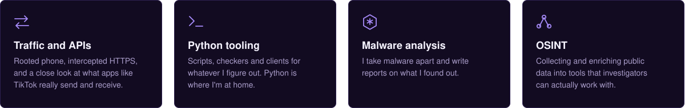

## What I code about

I'm a Python dev, and most of what I build starts the same way: an app does something and I want to know how. So I put a proxy between it and its server, read what goes back and forth, and turn that into a script, a tool or a write-up. I take malware apart and write reports on what I find, and I do bug bounty on the side.
